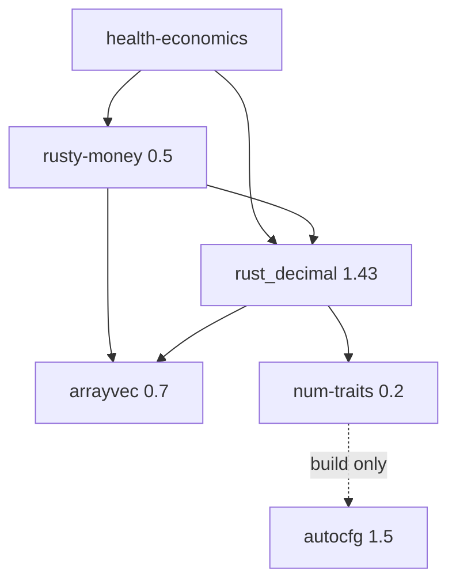

# Dependency graph

The production dependency graph is intentionally small and is reproducible with
`cargo tree --depth 3`.

`rusty-money` supplies public exact-currency values and delegates decimal
storage to `rust_decimal`; the crate also names `rust_decimal` directly to
construct and round exact amounts. All other metric modules use `std`. Test,
documentation, coverage, audit, and mutation tools are installed tools rather
than Cargo dependencies.

The lockfile, `cargo deny check`, and `cargo audit` are the authoritative inputs
for version, license, source, duplication, and advisory review. Do not infer
security or maintenance quality from graph size alone.
